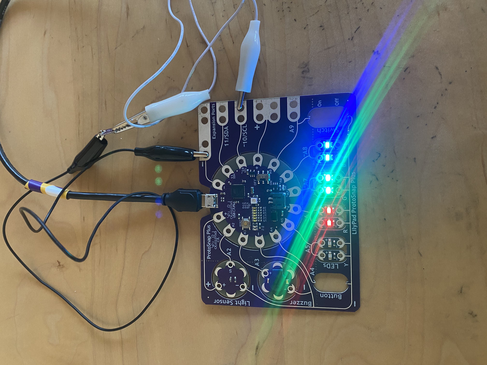

Bello!
For this project we had to store all the analog pins in an array and turn them on randomly at a
random brightness and only turn them off when they were randomly chosen again.
A tip I would like to give my past self is to use the bool isOn variable for helping check which
pin is turned on or not as that saves a lot of time.
Here is an image of my pins working as they're supposed to-

Poopaye!
Siya
