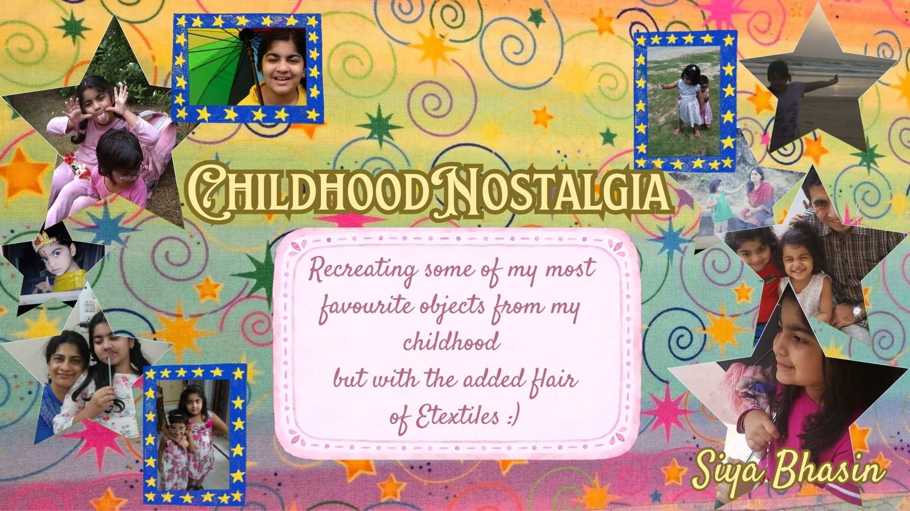
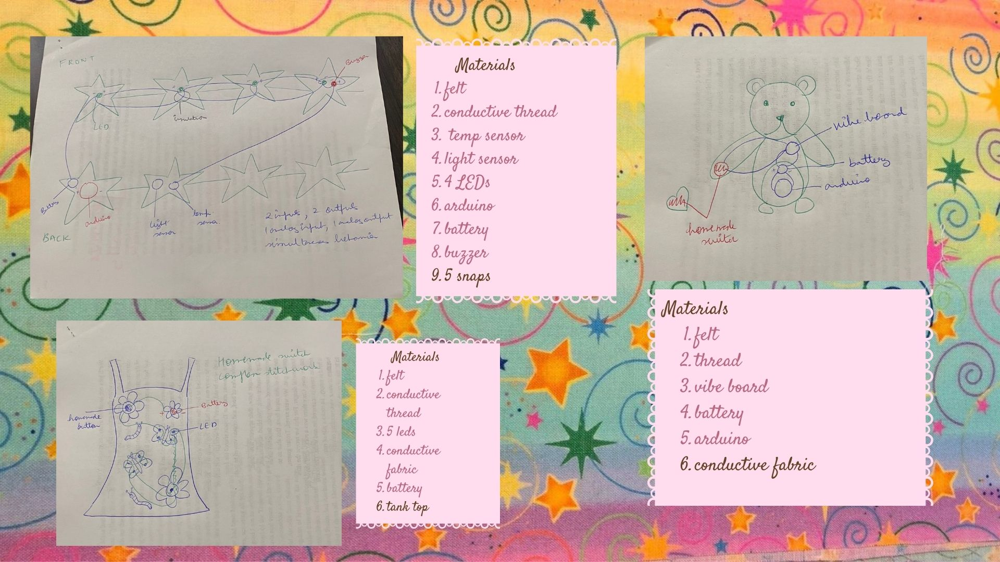

Bello!
Here is my presentation for my final project proposal:

For my theme, I chose to go with Childhood Nostalgia. I was inspired by the feeling of
certain objects and experiences appearing so magical to us as kids and them losing that flair
when we grow up. I wanted to recreate the magical experiences I remember having with objects
from my childhood using what I have learnt at Etextiles and that is my motivation behind picking this theme for my final project.
The three items I am planning to make are-
1. A star garland that flashes and plays twinkle twinkle little star whenever the lights are
   turned off and it is cold.
2. A tank top that brights up when a flower is pressed
3. A teddy bear that says you are safe through a vibe board when you press a heart to its palm (homemade switch)

Hope you like it :D Poopaye!
Siya
