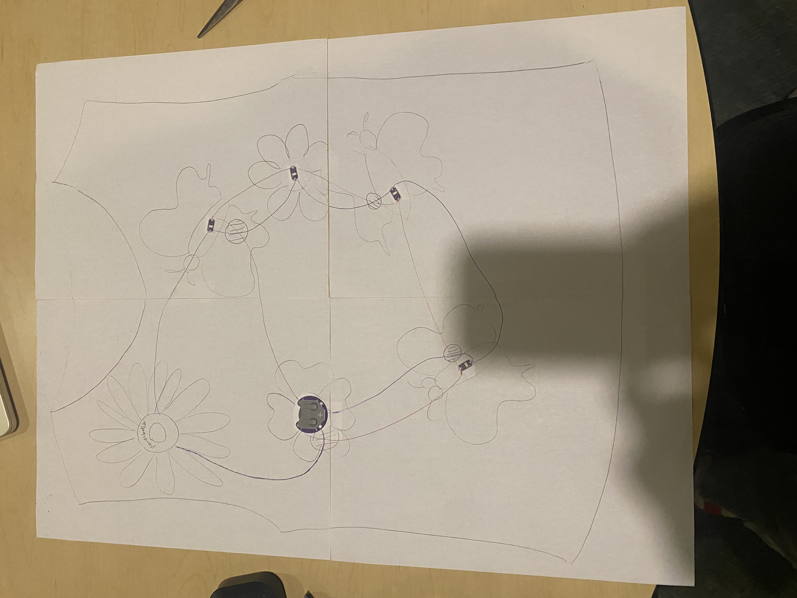
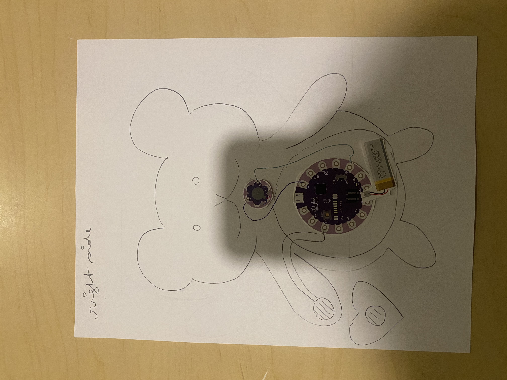
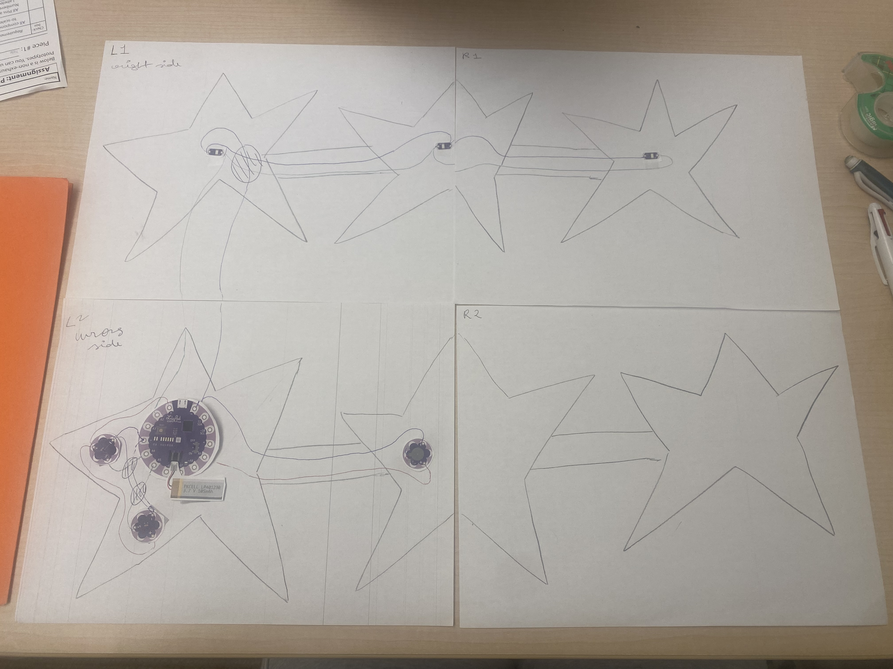

The theme for my final project is Childhood Nostalgia.
My theme aims to recreate the magic I remember seeing in simple childhood objects back when I was a kid. 
Here are the life-size paper prototypes for the three items in my final project!

**1. Butterfly Tank Top**
inspired from my favorite tank top as a kid, this tank top is going to have one of those classic flower buttons which when pressed will turn on LEDS sewn into elaborate flowers
and butterflies.

**2. Teddy Bear**
this bear will vibrate to "you're safe" when the button is pressed.

**3. Star Garland**
inspired by the glow in the dark stars on my ceiling that I was obsessed with as a kid. When it is dark and cold, the lights will turn on and twinkle twinkle little star will play.

